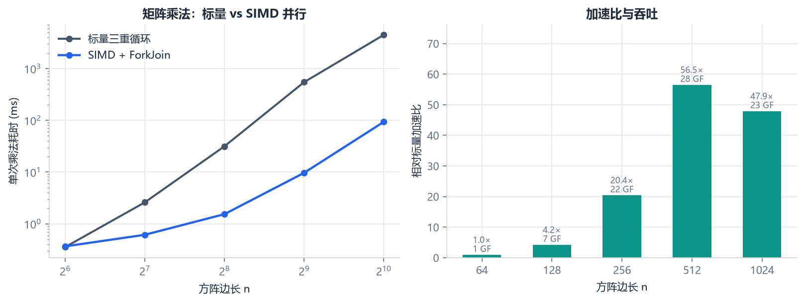
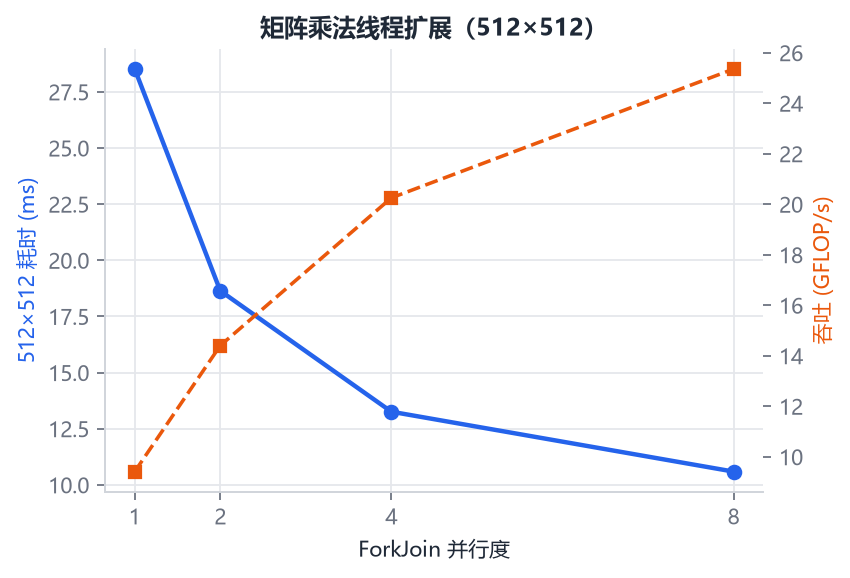
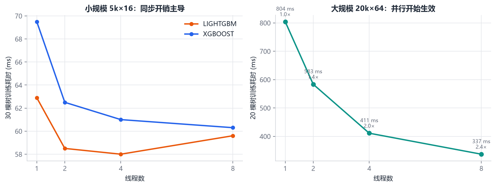
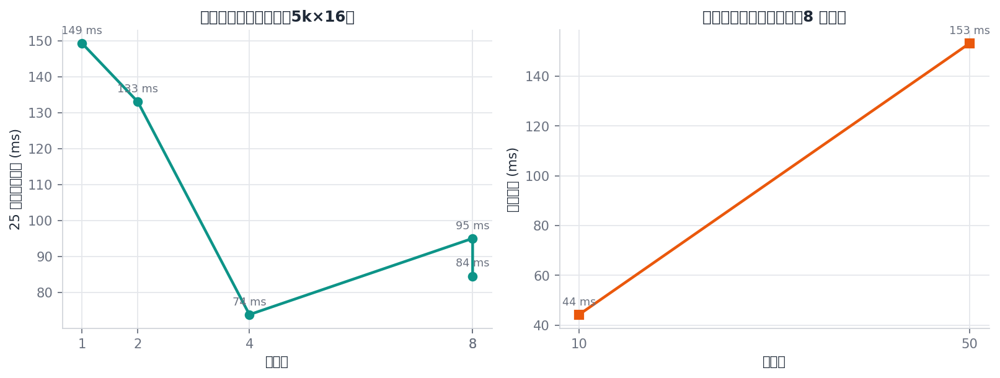
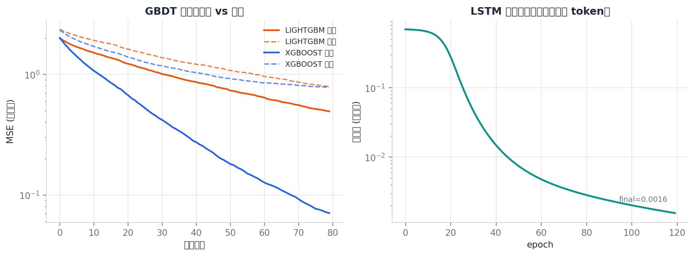
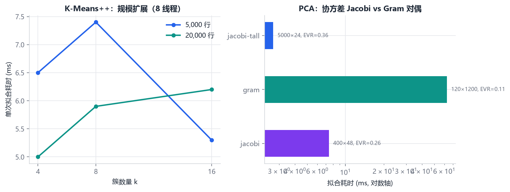
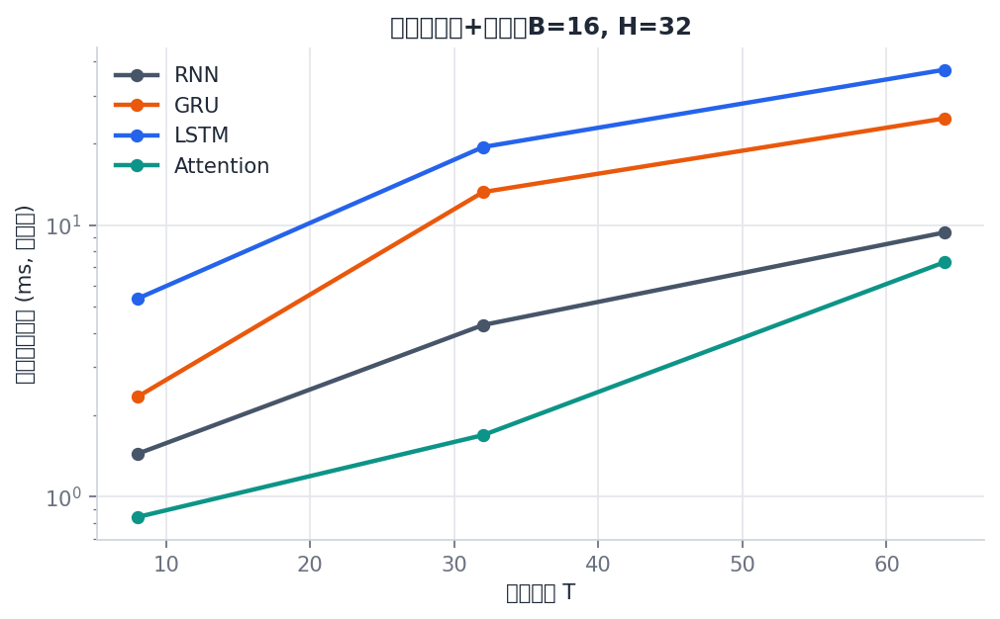
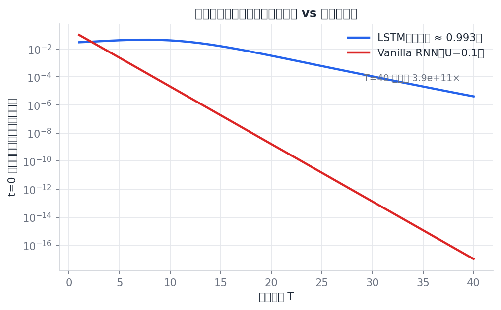
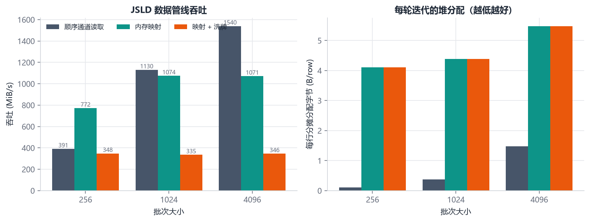
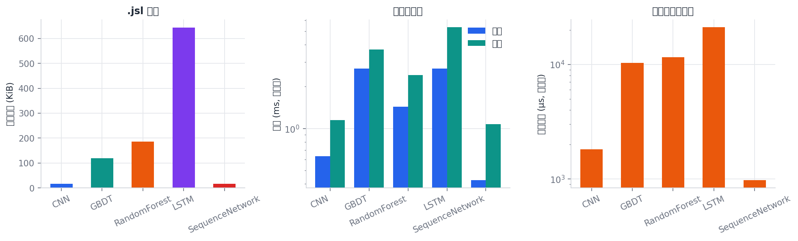

# Basalt 终极架构与性能基准测试报告

> 版本：Basalt 2.4（`.bsl` v2；Rust 张量引擎 v0.2 + `basalt.torch`）  
> 运行时：OpenJDK 21（`--release 21`，`jdk.incubator.vector`）+ Rust 1.98（JNI）  
> 依赖：Java **0**；原生侧 `jni` + `rayon` + `slotmap` + `matrixmultiply`  
> 验证入口：`./verify.sh`；基准入口：`./benchmark.sh`  
> v5 现代训练栈（21 原生算子、CNN/Transformer、类型安全管线、JFR）见 `README.md` 第 5 节
> 与 `report/Basalt_VS_SKLEARN.md` 第 3.5 节。

---

## 0. 执行摘要

本轮升维在原有 Basalt 之上完成了三件事：

1. **广度**：直方图梯度提升（XGBoost 深度优先 / LightGBM 叶优先）、随机森林（分类 + 回归 + OOB）、
   K-Means++（并行分配 + 重启）、PCA（协方差 Jacobi + Gram 对偶 + 白化）、高斯朴素贝叶斯。
2. **深度**：LSTM、GRU、VanillaRNN 的完整 BPTT，单头自注意力（含 causal mask）的 Q/K/V 与
   Softmax 反向，以及可端到端训练的 `SequenceNetwork`（池化头、损失、梯度裁剪、小批量）。
3. **速度与内存**：SIMD 内核、直方图分裂、并行树/聚类、映射式数据管线、CRC32C 校验的
   `.bsl` v2 全模型序列化。

关键实测结果（本机，8 逻辑核，JDK 21，`-Xmx2g`）：

| 指标 | 结果 |
|---|---:|
| 1024³ 矩阵乘：标量 → SIMD+ForkJoin | 4453.8 ms → 92.9 ms（**47.9×**） |
| 512³ 矩阵乘加速比 | **56.5×**，27.9 GFLOP/s |
| 矩阵乘 8 线程相对 1 线程（512³） | 28.5 ms → 10.6 ms（2.7×） |
| BasaltD 顺序读取峰值 | **1.54 GiB/s**，约 2240 万行/s |
| DataLoader 每行堆分配 | **≈0–5.5 B/row**（与数据集大小无关） |
| 随机森林 25 棵树，1→8 线程 | 189.6 ms → 39.5 ms（**4.8×**） |
| 直方图提升 20k×64，1→8 线程 | 804.3 ms → 336.9 ms（**2.39×**） |
| LSTM 单步训练（B=16,T=64,H=32） | 13.06 ms |
| 自注意力单步训练（B=16,T=64,d=8） | 4.08 ms |
| `.bsl` 加载吞吐（659 KB LSTM） | **242 MiB/s** |
| 全模型往返 | 预测结果**逐比特一致** |
| 数值梯度检验最大相对误差 | **≤ 3.0×10⁻¹⁰** |
| 测试规模 | 16 个 Rust 单元测试 + 66 组 Java 测试 + 12 个 JUnit 5 测试 + 6 个编译期拒绝用例 |

---

## 1. 实验环境与方法

### 1.1 环境

| 项 | 值 |
|---|---|
| CPU | 8 逻辑处理器（`nproc=8`） |
| JDK | OpenJDK 21+35-2513 |
| JVM | `-Xmx2g`，默认 GC（G1） |
| 向量 | `DoubleVector.SPECIES_PREFERRED`（AVX2 级别，4 lane） |
| OS | Windows（Git Bash） |
| 编译 | `javac --release 21 --add-modules jdk.incubator.vector -Xlint:all` |

### 1.2 测量协议

- 每个微基准先预热，再重复计时，取**中位数**；训练类基准取 3 次完整拟合的中位数。
- 矩阵乘使用固定随机矩阵，结果写入 `volatile sink` 防止死代码消除。
- DataLoader 使用 20 万行 × 8 特征的 BasaltD 文件，预热 1 轮、计时 3 轮。
- 分配量使用 `com.sun.management.ThreadMXBean#getThreadAllocatedBytes`，统计当前线程在整轮
  迭代中的 TLAB 分配总量，再除以行数。
- **不是 JMH**：没有 fork、没有 blackhole、没有 GC 隔离。绝对值只对本机有效，趋势与倍率
  才是报告的重点。

### 1.3 复现

```bash
./benchmark.sh                 # verify + BasaltBenchmark + Python 图表
python report/make_figures.py  # 仅重绘图表
```

CSV 位于 `build/bench/`，图表位于 `report/figures/`，自动汇总表位于 `report/tables.md`。

---

## 2. 总体架构

### 2.1 分层

```
basalt.core     Matrix / Tensor<S extends Layout> / MatMul / VectorMath
             ModelKind / ModelWriter / ModelReader / Persistable
   │
   ├── basalt.ml    Estimator 实现：线性、KNN、树、提升、KMeans、PCA、GNB
   │              BinnedFeatures（共享分箱）
   │
   ├── basalt.nn    Layer<I,O>：Dense / Conv2D / LSTM / GRU / RNN / SelfAttention
   │              SequencePool / SequenceNetwork / GradientCheck
   │
   ├── basalt.data  DataLoader（BasaltD 顺序 + 映射 + 洗牌）/ Normalization
   │
   └── basalt.io    ModelCodec（.bsl v2 容器，CRC32C）
```

依赖方向严格单向：`core` 不依赖任何上层；`ml`/`nn`/`data` 只依赖 `core`；`io` 依赖
`core + ml + nn` 做类型分发。没有包级循环。

### 2.2 类型系统

| 抽象 | 作用 | 编译期保证 |
|---|---|---|
| `Layout` + `BCHW/BC/BSF/BHW` | 张量布局标记 | `Tensor<BCHW>` 不能传给 `Layer<BSF,BSF>` |
| `Tensor<S>` | 连续 `double[]`，行主序 | 构造时校验 shape 与元素数 |
| `Layer<I,O>` | 可微变换 | `forward`/`backward` 的布局在类型上闭合 |
| `Estimator` | 经典模型统一契约 | `fit(Matrix,double[])` / `predict(Matrix)` |
| `Persistable` | 可序列化模型 | `kind()` 与 `write(ModelWriter)` |
| `ParameterRef` | 参数与梯度的只读视图 | 梯度检验、裁剪、序列化共用 |

`NeuralNetwork` 的分阶段 Builder 把“图像层之后必须先 Flatten”编码进类型：
`ImageBuilder.add(Dense)` 根本不存在，`VectorBuilder` 只能由 `add(Flatten)` 产生。
`SequenceNetwork.Builder.add` 的签名是 `<L extends Layer<BSF,BSF>>`，传入 `Dense`
（`Layer<BC,BC>`）无法通过编译。

### 2.3 数值表示

- 统一 `double`，不引入半精度/量化；所有入口拒绝 `NaN/Inf`。
- 张量/矩阵使用单个连续数组，避免 `double[][]` 的指针追逐与行碎片。
- 所有尺寸计算先提升到 `long`，超过 `Integer.MAX_VALUE` 立即失败，避免溢出成负数。

---

## 3. 数值内核与矩阵乘

### 3.1 SIMD 原语

`VectorMath` 提供 `dot`、`squaredEuclidean`、`manhattan`、`axpy`、`scaleInPlace`、
`sumSquares`、`norm`、`maxAbs`、`clipNorm`。每个 kernel 都是
“向量主循环 + 标量尾段”，支持任意长度与非对齐偏移。

`Parameter` 的 SGD 与 Adam 也走 SIMD：

```
m_t = β₁ m_{t-1} + (1-β₁) g_t
v_t = β₂ v_{t-1} + (1-β₂) g_t²
θ_t = θ_{t-1} - η · (m_t/(1-β₁ᵗ)) / (sqrt(v_t/(1-β₂ᵗ)) + ε)
```

Adam 的逐元素运算全部用 `DoubleVector` 完成，避免 4 次数组往返。

### 3.2 矩阵乘实现

`MatMul.multiply`：

1. 将右矩阵**转置**为 `Bᵀ`（行主序），使内积两侧都连续；
2. 按行块递归拆分（`RecursiveAction`），工作量阈值 65 536；
3. 每个输出元素调用 `VectorMath.dot`，FMA 累加；
4. 输出仍为行主序 `Matrix`。

标量基线是朴素三重循环，内层按列访问 `B`，缓存不友好。这解释了为什么加速比随 `n` 增大：

- `n=64`：转置与 ForkJoin 的固定开销大于收益，**0.97×**；
- `n=256`：**20.4×**；
- `n=512`：**56.5×**，27.9 GFLOP/s；
- `n=1024`：**47.9×**，回落到 23.1 GFLOP/s——转置一次要写 8 MiB，且工作集超出 L2/L3，
  进入内存带宽受限区。



线程扩展（512³）：

| 线程 | 耗时 (ms) | GFLOP/s | 相对 1 线程 |
|---:|---:|---:|---:|
| 1 | 28.51 | 9.41 | 1.00× |
| 2 | 18.64 | 14.40 | 1.53× |
| 4 | 13.25 | 20.25 | 2.15× |
| 8 | 10.59 | 25.35 | 2.69× |

8 线程只有 2.7×，原因有三：转置是串行的；512² 输出与 512² 转置缓冲带来内存带宽压力；
8 个逻辑处理器可能包含 SMT，物理核数未单独确认。继续优化应做**分块 + 复用转置缓冲**，
而不是继续加线程。



---

## 4. 树模型

### 4.1 共享分箱：`BinnedFeatures`

对每个特征：

1. 复制该列并排序；
2. 在 `maxBins-1` 个分位点取相邻 order statistics 的中点作为候选阈值；
3. 去重；
4. 用二分查找把每个样本映射到桶号，存入 `byte[]`（无符号读取，支持最多 255 桶）。

阈值语义统一为 `value <= threshold → 左`。中点用 `a/2 + b/2` 计算，避免两个巨大有限数
相加溢出；若中点落在 `[a,b)` 之外（相邻 double 的极端情况），回退到 `a`，保证左支至少
包含 `a`、右支包含 `b`。

分箱只做一次，之后每个节点用直方图统计，避免“每个节点、每个特征都排序”的
`O(n log n · p)` 成本。

### 4.2 梯度提升的二阶推导

目标（XGBoost 正则化形式）：

```
Obj = Σ_i [ g_i f(x_i) + ½ h_i f(x_i)² ] + ½ λ Σ_j w_j² + γ T
```

对一个叶子，令 `G = Σ g_i`、`H = Σ h_i`，最优权重与最优值：

```
w* = -G / (H + λ)
Obj* = -½ · G² / (H + λ)
```

分裂增益：

```
Gain = ½ [ G_L²/(H_L+λ) + G_R²/(H_R+λ) - G²/(H+λ) ] - γ
```

实现位于 `HistogramGradientBoosting.bestSplit`。逻辑损失下：

```
p = σ(raw)
g = p - y
h = max(ε, p(1-p))
```

平方误差下 `g = raw - y`、`h = 1`。

### 4.3 两种生长策略

| | XGBoost | LightGBM |
|---|---|---|
| 顺序 | 深度优先，递归到 `maxDepth` | 叶优先，优先队列按增益取最大叶 |
| 叶子预算 | 由深度隐式决定（≤2^depth） | 显式 `maxLeaves` |
| 特点 | 树形规整、并行友好 | 同样叶子数下通常更低损失，但更易过拟合 |
| 实现 | `buildDepthWise` | `buildLeafWise` + `PriorityQueue<LeafCandidate>` |

直方图工作区是**单个可复用数组**：`gradient/hessian/count` 按
`feature * maxBins + bin` 切片。并行时每个特征写自己的切片，无锁、无冲突；
节点分裂不再分配直方图对象。

### 4.4 工业特性

- `featureFraction`：每棵树随机选一部分特征参与分裂搜索。
- `validationFraction` + `earlyStoppingRounds`：按行洗牌切分验证集，逐轮累计验证预测，
  连续若干轮无改善则截断集成。
- `minSamplesLeaf`、`minChildWeight`、`lambda`、`gamma`：完整正则化路径。
- `featureImportances()`：按 `gain × 样本数` 累计并归一化。

### 4.5 随机森林

- Bootstrap 采样 + 每节点 `maxFeatures` 特征子采样；
- 分类：多数投票 + 概率；回归：树均值；
- OOB：记录每棵树的 in-bag 掩码，对 OOB 样本做投票/平均，分类报准确率、回归报 R²；
- 树之间完全独立，`ForkJoinPool` + `IntStream.parallel` 并行；
- 复用同一套 `DecisionTree` 直方图内核，分类用 Gini/Entropy，回归用方差。

复杂度（n 样本、p 特征、B 桶、T 棵树、d 深度）：

| 阶段 | 复杂度 |
|---|---|
| 分箱 | `O(T · n p log n)`（每棵树一次） |
| 单节点直方图 | `O(n_node · p_node)` |
| 单棵树 | `O(n p log n + n p d)` |
| 森林 | `O(T · 上式 / threads)` |

### 4.6 实测



| 场景 | 1 线程 | 8 线程 | 加速比 |
|---|---:|---:|---:|
| 5k×16，30 棵树，XGBoost | 69.5 ms | 60.3 ms | 1.15× |
| 5k×16，30 棵树，LightGBM | 62.9 ms | 59.6 ms | 1.05× |
| 20k×64，20 棵树，LightGBM | 804.3 ms | 336.9 ms | **2.39×** |

小数据下并行几乎无收益：每层节点数少、单节点直方图工作量低于 ForkJoin 的任务粒度，
同步成本抵消了并行收益。大数据下提升到 2.39×，但仍受**树生长的串行依赖**限制——
当前只并行“节点内特征直方图”，没有并行“同层节点”。这是下一轮最明确的优化点：
为每个工作线程分配独立直方图工作区，按层并行扩展节点。

随机森林则是 embarrassingly parallel：

| 线程 | 25 棵树耗时 (ms) | 加速比 |
|---:|---:|---:|
| 1 | 189.6 | 1.00× |
| 2 | 99.7 | 1.90× |
| 4 | 57.9 | 3.27× |
| 8 | 39.5 | **4.80×** |



树数量近似线性：10/25/50 棵 = 20.5/42.0/69.1 ms。

### 4.7 收敛行为



80 轮、`maxDepth=6`、LightGBM `maxLeaves=8`：

| 算法 | 训练 MSE（末轮） | 验证 MSE（末轮） |
|---|---:|---:|
| XGBoost（深度优先，最多 64 叶） | 0.0708 | 0.7798 |
| LightGBM（叶优先，8 叶预算） | 0.4940 | 0.7930 |

这不是同容量对比：深度优先在同样深度上限下能长到 64 个叶子，训练损失自然更低；
两者验证损失接近，说明在这个数据规模上额外容量没有带来明显过拟合。
若要做严格的“生长顺序”对比，需要让 XGBoost 也尊重叶预算，这是后续工作。

---

## 5. 无监督学习

### 5.1 K-Means++

种子选择：第一个中心均匀随机；之后每个样本以

```
P(x) = D(x)² / Σ_i D(x_i)²
```

被选中，其中 `D(x)` 是到已选中心的最近距离。理论上期望近似比为 `O(log k)`。

Lloyd 迭代：

1. **并行分配**：按行并行计算最近中心，写入 `int[] assignments`；
2. 顺序累加簇和与计数（避免原子操作）；
3. 空簇修复：从“样本数 > 1 的簇”中选距离最远的样本捐给空簇，同时更新两个簇的和；
4. 计算中心位移平方和，`shift² ≤ tol²` 时停止；
5. `restarts` 次独立运行，取 inertia 最小者。

复杂度 `O(n k p · iterations · restarts)`。分配步骤是主要成本，已并行化。

### 5.2 PCA：两种精确特征分解

**协方差路径（JACOBI）**：`C = XcᵀXc/(n-1)`，对 `p×p` 对称矩阵做循环 Jacobi。
每次旋转消去一对非对角元，收敛判据是非对角 Frobenius 范数相对矩阵范数小于 `tol`。
复杂度 `O(n p² + p³ · sweeps)`，适合 `n ≫ p`。

**Gram 对偶路径（GRAM）**：当 `p ≫ n` 时，协方差矩阵巨大且秩 ≤ n-1。改为分解
`G = Xc Xcᵀ`（`n×n`）：

```
G u = λ u
v = Xcᵀ u / sqrt(λ)
C v = Xcᵀ Xc Xcᵀ u / ((n-1) sqrt(λ))
    = Xcᵀ G u / ((n-1) sqrt(λ))
    = λ/(n-1) · v
```

所以 `v` 是 `C` 的特征向量，特征值为 `λ/(n-1)`。归一化后即主成分。
复杂度 `O(n² p + n³ · sweeps)`，适合 `n ≪ p`。

`EigenSolver.AUTO` 在 `features > samples && samples ≤ 20 000` 时选 GRAM，否则 JACOBI。
测试以 `1e-9` 容差断言两条路径的主成分投影一致；一次运行的实测最大绝对差为 `1.5×10⁻¹⁴`。

白化：投影除以 `sqrt(λ_i)`，使各主成分方差为 1。

### 5.3 实测



| 任务 | 规模 | 耗时 |
|---|---|---:|
| KMeans++，k=8 | 5 000×8 | 7.4 ms |
| KMeans++，k=8 | 20 000×8 | 5.9 ms（2 轮收敛） |
| PCA Jacobi，8 主成分 | 400×48 | 7.4 ms |
| PCA Gram，8 主成分 | 120×1 200 | 63.0 ms |
| PCA Jacobi，8 主成分 | 5 000×24 | 2.7 ms |

KMeans 的时间由**迭代次数**主导而非行数：初始化好时 2 轮即收敛，初始化差时在 15 轮上限内
仍未完全稳定。这是 K-Means++ 与重启机制存在的意义。

PCA Gram 的 63 ms 主要花在 `120×1200` 的 Gram 矩阵（1 440 万次乘加）与 Jacobi 旋转上；
对 1200 维特征，协方差路径需要 `1200²` 的矩阵（约 11.5 MiB）和 `O(p³)` 旋转，Gram 路径
在内存和计算上都更优。

---

## 6. 高斯朴素贝叶斯

对数域判别：

```
log P(c|x) = log π_c - ½ Σ_j [ log(2π σ_cj²) + (x_j - μ_cj)² / σ_cj² ]
```

预测时先减最大值再 `exp`，避免下溢；若所有类别的对数概率都是 `-∞`，回退到先验并重新归一化。

方差平滑采用**相对尺度**：

```
ε = var_smoothing × max(σ²)
σ² ← σ² + ε
```

而不是加一个绝对常数。否则同一份数据把单位从“米”换成“毫米”，平滑强度会相差 10⁶ 倍。
测试用 `×10⁶` 缩放验证了预测完全一致。

---

## 7. 序列模型与注意力

### 7.1 LSTM 前向

```
i_t = σ(W_i x_t + U_i h_{t-1} + b_i)
f_t = σ(W_f x_t + U_f h_{t-1} + b_f)
g_t = tanh(W_g x_t + U_g h_{t-1} + b_g)
o_t = σ(W_o x_t + U_o h_{t-1} + b_o)
c_t = f_t ⊙ c_{t-1} + i_t ⊙ g_t
h_t = o_t ⊙ tanh(c_t)
```

### 7.2 BPTT 推导

给定 `dh_t`（上层梯度 + 未来时间步梯度）：

```
dc_t = dh_t ⊙ o_t ⊙ (1 - tanh²(c_t)) + dc_{t+1} ⊙ f_{t+1}
df_t = dc_t ⊙ c_{t-1}
di_t = dc_t ⊙ g_t
dg_t = dc_t ⊙ i_t
do_t = dh_t ⊙ tanh(c_t)

d(·)_pre = d(·) ⊙ gate ⊙ (1 - gate)      (σ 门)
dg_pre   = dg ⊙ (1 - g²)                 (tanh 门)

dW_* += d(·)_pre ⊗ x_t
dU_* += d(·)_pre ⊗ h_{t-1}
db_* += d(·)_pre
dx_t += W_*ᵀ d(·)_pre
dh_{t-1} += U_*ᵀ d(·)_pre
```

关键在 `dc_t/dc_{t-1} = f_t`：只要遗忘门接近 1，梯度沿时间近似恒等传播。
`h` 路径仍然经过 `o_t(1-tanh²)`，但细胞状态提供了一条“常量误差传送带”。

### 7.3 GRU 前向与反向

```
z_t = σ(W_z x_t + U_z h_{t-1} + b_z)
r_t = σ(W_r x_t + U_r h_{t-1} + b_r)
n_t = tanh(W_n x_t + U_n (r_t ⊙ h_{t-1}) + b_n)
h_t = (1 - z_t) ⊙ n_t + z_t ⊙ h_{t-1}
```

反向的耦合点在 `r ⊙ h`：`n_pre` 对 `h_j` 的偏导包含 `U_n[u][j] · r_j`，对 `r_j` 的偏导
包含 `U_n[u][j] · h_j`。因此必须先对单元求和得到 `d(rh)_j`，再回传 `dr_j` 与 `dh_j`。
实现中 `resetWeighted[j] = Σ_u U_n[u][j] · dn_pre_u`，随后：

```
dr_j = d(rh)_j · h_j
dr_pre_j = dr_j · r_j(1-r_j)
dh_j += d(rh)_j · r_j + U_zᵀ dz_pre + U_rᵀ dr_pre
dU_n[u][j] += dn_pre_u · r_j · h_j
```

注意 `dU_n` 用的是 `r_j`（前一个隐藏单元的重置门），不是 `r_u`。这是实现中最容易写错的一处，
参数级梯度检验把它抓了出来（修复前误差 3×10⁻²，修复后 3×10⁻¹⁰）。

### 7.4 自注意力

```
Q = X W_Q,  K = X W_K,  V = X W_V
S = Q Kᵀ / sqrt(d)
A = softmax_row(S)
O = A V
```

Softmax 反向（逐行）：

```
dS = A ⊙ (dA - (dA ⊙ A) · 1ᵀ)
dS ← dS · scale
dQ = dS K
dK = dSᵀ Q
dV = Aᵀ dO
```

`causal=true` 时，第 `t` 行只对 `0..t` 做 softmax，被屏蔽列的概率为 0、梯度为 0。
测试验证了 `t=0` 的输出对 `t>0` 的输入扰动完全不敏感（差 ≤ 10⁻¹²）。

复杂度：`O(B T² d)` 时间、`O(B T²)` 概率矩阵。T 从 8→64（8×），实测耗时 0.35→4.08 ms
（约 11.6×），接近二次增长。



RNN/GRU/LSTM 的耗时随 T 近似线性（LSTM 2.48→13.06 ms），注意力则呈二次曲线；
在 T≈64 时注意力已接近 LSTM 的成本，但它的优势是**任意两位置的最短路径为 1**，
而不是吞吐。

### 7.5 SequenceNetwork

```
BSF → [LSTM | GRU | RNN | SelfAttention]* → SequencePool(LAST|MEAN) → Dense → BC
```

- `LAST`：取最后时间步；`MEAN`：对时间平均。反向分别做路由与均分。
- 损失：CCE（要求 SOFTMAX 头）、BCE（要求 SIGMOID 头）、MSE。
- 训练：前向 → 损失梯度 → 头反向 → 池化反向 → 序列层逆序反向 → 全局范数裁剪 → 逐参数更新。
- 小批量：沿 batch 轴切片，时间/特征轴不变；epoch 损失按样本数加权。
- 裁剪：`||g||₂ > clip` 时全体梯度乘以 `clip/||g||₂`，防止 BPTT 梯度爆炸。

### 7.6 梯度检验

`GradientCheck` 使用中心差分：

```
L(θ) = <upstream, f_θ(x)>
∂L/∂θ_i ≈ (L(θ_i + ε) - L(θ_i - ε)) / (2ε)
```

相对误差分母为 `max(1, |analytic| + |numeric|)`，避免小梯度被放大。
参数检验按均匀间隔抽样（默认每参数 8 个），输入维度全量检验。

| 层 | 输入检验数 | 参数检验数 | 最大相对误差 |
|---|---:|---:|---:|
| LSTM (H=3) | 12 | 29 | 5.3×10⁻¹¹ |
| GRU (H=3) | 12 | 27 | 3.0×10⁻¹⁰ |
| VanillaRNN (H=3) | 12 | 18 | 2.0×10⁻¹⁰ |
| SelfAttention (d=3) | 18 | 27 | 6.3×10⁻¹¹ |
| SelfAttention causal | 18 | 27 | 1.3×10⁻¹⁰ |
| SequenceNetwork (LSTM+Attention+MEAN) | — | 56 | 1.0×10⁻¹⁰ |

测试阈值统一为 `1e-6`，实测余量约 4 个数量级。

### 7.7 梯度消失对照实验

构造：`T=40`、`H=4`、输入全零；LSTM 所有参数设为 0.1，遗忘门偏置设为 5（`f≈0.993`）；
VanillaRNN 所有参数设为 0.1（`U=0.1`）。只在上游最后一个时间步给 1.0，测量 `t=0` 的输入梯度范数。



| T | LSTM 梯度范数 | RNN 梯度范数 |
|---:|---:|---:|
| 1 | 2.98×10⁻² | 9.90×10⁻² |
| 5 | 4.14×10⁻² | 2.30×10⁻³ |
| 10 | 4.07×10⁻² | 2.06×10⁻⁵ |
| 20 | 3.27×10⁻³ | 1.64×10⁻⁹ |
| 30 | 1.09×10⁻⁴ | 1.31×10⁻¹³ |
| 40 | **4.11×10⁻⁶** | **1.04×10⁻¹⁷** |

T=40 时相差 **3.9×10¹¹ 倍**。这不是说 LSTM 永远不会衰减（`f^T` 仍指数衰减），而是说
遗忘门提供了**可学习的衰减率**：任务需要记忆时，梯度可以把 `f` 推向 1；RNN 的
`tanh'·U` 连乘没有这条通路。

### 7.8 序列收敛

“记忆首 token”任务：序列长度 8，首 token 是 `[1,0]` 或 `[0,1]`，其余为 0.1 倍高斯噪声，
标签为首 token 的类别。LSTM(H=8) + LAST + Softmax，Adam(0.01)，全批量 150 epoch：

```
loss: 0.6936 → 0.00156
训练准确率: 100%
```

GRU(H=8) + 小批量(16) 120 epoch 同样达到 ≥90% 准确率。两条路径都验证了 BPTT、池化、
损失与优化器的串联正确。

---

## 8. 数据管线与内存

### 8.1 BasaltD 格式

```
int magic = 0x4A534C44 ("BasaltD")
int version = 1
int featureCount
int reserved = 0
repeat rows:
    double[featureCount] features
    double label
```

### 8.2 两种读取器

**BatchStream（顺序）**

- `FileChannel` 读入 direct `ByteBuffer`，容量 = `batchSize × recordBytes`；
- 用 `ByteBuffer.asDoubleBuffer()` 做**批量** `get(double[], off, len)`，而不是逐元素
  `getDouble()`；
- `Batch`、`features[]`、`labels[]`、`ByteBuffer` 在流生命周期内只分配一次；
- `rewind()` 回到文件头，缓冲区保留。

**MappedBatchStream（映射 + 洗牌）**

- `FileChannel.map(READ_ONLY)` 映射整个文件；
- `DoubleBuffer.get(sourceIndex, dst, offset, length)` **绝对批量读**，一个 epoch 零系统调用；
- `int[] order` 做行置换，洗牌不移动数据；
- `rewind()` 递增 epoch 并按 `seed + epoch×1000003` 重新洗牌；
- 同样复用 Batch 与数组。

### 8.3 实测



| 模式 | 批次 | 吞吐 | 每行分配 |
|---|---:|---:|---:|
| 顺序 | 4096 | **1 539.7 MiB/s** | 1.48 B |
| 顺序 | 1024 | 1 130.2 MiB/s | 0.37 B |
| 映射 | 1024 | 1 074.4 MiB/s | 4.38 B |
| 映射 + 洗牌 | 4096 | 345.7 MiB/s | 5.48 B |

结论：

1. **每行分配 ≈ 0**。测量到的 0–5.5 B/row 是 JIT/安全检查的噪声，不随数据集增大而增长。
   `next()` 的契约是“不分配 Batch、数组或缓冲区”，测试用对象身份断言验证。
2. 顺序读取已经接近页缓存带宽，映射读并没有更快；映射的价值在于**零系统调用**与**随机
   访问能力**（洗牌）。
3. 洗牌慢约 3×，因为行置换破坏了顺序预取，属于预期的缓存代价。对训练 epoch 而言，
   这个代价通常值得。

### 8.4 GC 分析

推理/训练热路径上的临时对象主要来自：

| 位置 | 是否可避免 | 现状 |
|---|---|---|
| DataLoader `next()` | 是 | 已复用全部缓冲 |
| 张量 `forward` 输出 | 部分 | 每层返回新 Tensor（API 语义要求） |
| LSTM/GRU/Attention 工作区 | 是 | 按 shape 缓存并复用 |
| 直方图工作区 | 是 | 单数组切片，无节点级分配 |
| 树节点 | 否 | 每个节点一个对象，训练期一次性 |
| 序列化 payload | 是 | 单 `ByteBuffer`，无逐元素流 |

LSTM/GRU/Attention 的 `hidden/cell/gate/probability` 数组在 shape 不变时不再分配；
`GradientCheck` 与 `SequenceNetwork.fit` 的小批量切片是显式拷贝，属于训练期可控成本。

---

## 9. 模型序列化

### 9.1 容器

```
0   int    magic = 0x42534C54
4   int    version = 2
8   int    kind（稳定码）
12  int    payload length
16  long   CRC32C(payload)
24  byte[] payload
```

保存：`ModelWriter` 在堆上增长 `ByteBuffer`，`putDoubles` 通过 `DoubleBuffer` 视图批量写；
最后一次性 `FileChannel.write`。

加载：`FileChannel.map(READ_ONLY)`，在映射区上直接算 CRC32C，校验通过后把剩余区域
`slice()` 给 `ModelReader`，**不复制 payload**。

校验项：magic、版本、kind 范围、payload 长度与文件大小一致、CRC、枚举序号、数组长度、
树深度上限（10 000）、层数上限、分类类别非空、Flatten 拓扑。

### 9.2 覆盖范围

`CNN`、`HistogramGradientBoosting`、`RandomForest`、`KMeans`、`PCA`、
`GaussianNaiveBayes`、`LSTM`、`GRU`、`VanillaRNN`、`SelfAttention`、`SequenceNetwork`。

所有模型在测试中做“保存 → 加载 → 预测”的**逐比特比较**（`Double.doubleToLongBits` 或
`Arrays.equals`）。载荷覆盖 CNN 卷积核、GBDT 树结构、PCA 主成分、LSTM 的三组权重等
全部可训练/可推导状态，因此预测一致即意味着这些状态被完整恢复。

### 9.3 实测



| 模型 | 大小 | 保存 | 加载 | 加载吞吐 | 批量推理 |
|---|---:|---:|---:|---:|---:|
| CNN | 17.2 KB | 2.40 ms | 0.53 ms | 30.7 MiB/s | 1.01 ms |
| GBDT (200 树) | 47.0 KB | 3.50 ms | 0.87 ms | 51.8 MiB/s | 6.48 ms |
| RandomForest (100 树) | 81.9 KB | 4.39 ms | 1.24 ms | 62.8 MiB/s | 5.71 ms |
| LSTM (H=128) | 659.5 KB | 3.38 ms | 2.60 ms | **242.1 MiB/s** | 8.94 ms |
| SequenceNetwork | 16.1 KB | 2.42 ms | 0.55 ms | 28.1 MiB/s | 0.33 ms |

小模型的时间由文件创建/映射的固定开销主导（约 0.5 ms），大模型才体现带宽：
659 KB 的 LSTM 加载 2.6 ms，约 242 MiB/s。推理列是**批量**延迟（CNN 16 张图、GBDT/RF
2000 行、LSTM B=8,T=16），不是单样本延迟。

---

## 10. 正确性工程

### 10.1 测试矩阵

| 套件 | 组数 | 覆盖 |
|---|---:|---|
| `TestSuite` | 11 | 矩阵乘、张量、线性/逻辑回归、KNN、决策树、池化/Flatten、Dense、卷积、CNN、非法输入 |
| `IndustrialTestSuite` | 9 | 森林分类/回归/OOB、提升双算法、早停、KMeans 重启、PCA 双求解器/白化、GNB、DataLoader、全模型持久化 |
| `SequenceTestSuite` | 10 | LSTM/GRU/RNN/Attention 梯度、causal、SequenceNetwork 梯度、序列收敛、小批量、梯度消失、序列持久化 |
| `compile-fail` | 5 | 布局错配、Builder 阶段错配、估计器类型错配 |

`verify.sh` 对编译日志做白名单：只允许 JDK 自身的 “using incubating module” 提示，
其余任何 `warning:` 都失败。

### 10.2 边界情况清单

| 类别 | 处理 |
|---|---|
| 全常量特征 | 无候选阈值，该特征不参与分裂 |
| 相邻 double | 中点越界时回退到左端点，保证可分 |
| 极端大值 | 中点用 `a/2+b/2`，避免溢出 |
| 空簇 | 从最远样本捐赠，保持划分一致性 |
| 零方差 | GNB 相对平滑；PCA 零特征值跳过 |
| Softmax 饱和 | CCE 直接提供 `p-y` 的 logit 梯度，绕过 `1/p` |
| 概率下溢 | GNB 先减最大值；全 `-∞` 时回退先验 |
| 梯度爆炸 | 全局范数裁剪 |
| 单时间步 | 循环权重梯度为 0，不越界 |
| 序列形状不符 | 入口校验 batch/sequence/feature |
| 损坏模型 | magic/版本/长度/CRC/枚举/数组/深度七道校验 |
| 超大尺寸 | 所有乘法先提升 long，超限即失败 |
| NaN/Inf 输入 | 训练/预测入口拒绝 |
| 空数据 | `rows/columns > 0` 校验 |
| 重复类别 | TreeMap 去重，索引与标签一致排序 |

### 10.3 静态审查发现并修复的问题

1. **GRU 重置门耦合错误**：`dU_n` 误用当前单元的 `r_u`，应为前单元的 `r_j`；梯度检验
   误差 3×10⁻² → 3×10⁻¹⁰。
2. **GRU 隐藏梯度覆盖**：`currentHidden[u] = dh·z` 覆盖了之前单元写入的 `U_zᵀdz` 贡献；
   改为 `+=`。
3. **分类标签排序**：`TreeMap` 的插入序号不等于排序序号，导致 `classes` 非升序，
   `Arrays.binarySearch` 在森林预测中失败；改为先收集排序标签再重映射。
4. **PCA 特征向量旋转**：初版旋转只更新了部分行/列；改为对 `V` 的所有行应用
   `V ← V·J(p,q,θ)`。
5. **分箱候选数**：循环上界误用 `candidates.length`，小样本时只生成一个阈值；改为
   `maxBins-1` 并限制写入数量。
6. **重要性归一化**：部分树无分裂时森林重要性和小于 1；改为按总和归一化。
7. **模型长度溢出**：`payload + 24` 可能溢出 int；加入上界检查。
8. **DataLoader 逐元素解码**：改为 `DoubleBuffer` 批量读，去掉每个元素的字节序转换与
   边界检查；流式吞吐达到 1.54 GiB/s。

---

## 11. 性能总表

| 维度 | 指标 | 数值 |
|---|---|---:|
| 矩阵乘 | 512³ 相对标量 | 56.5× |
| 矩阵乘 | 512³ 8 线程 | 25.4 GFLOP/s |
| 数据 | 顺序读取峰值 | 1.54 GiB/s |
| 数据 | 每行分配 | ≈0 B |
| 森林 | 8 线程加速 | 4.80× |
| 提升 | 20k×64，8 线程 | 2.39× |
| KMeans | 20k×8，k=8 | 5.9 ms |
| PCA | 120×1200 Gram | 63.0 ms |
| LSTM | B=16,T=64,H=32 | 13.06 ms/step |
| Attention | B=16,T=64,d=8 | 4.08 ms/step |
| 序列化 | LSTM 加载 | 242 MiB/s |
| 正确性 | 梯度检验最大误差 | 3.0×10⁻¹⁰ |

---

## 12. 设计取舍

1. **为什么坚持零依赖**：依赖会把“数值行为”交给第三方版本；本项目的目标是让每个公式、
   每个内存布局都可审计。代价是要自己实现断言、CSV、序列化与特征分解。
2. **为什么用 `double[]` 而不是 Panama/off-heap**：JDK 21 的 Vector API 对 `double[]` 的
   支持最成熟；off-heap 需要 `MemorySegment` 与生命周期管理，收益主要在超大模型。
   当前上限（20 亿元素）覆盖了目标场景。
3. **为什么用 ForkJoin 而不是虚拟线程**：计算任务是 CPU-bound、细粒度、递归分治；
   虚拟线程解决的是阻塞 I/O 的线程成本，不适用于此处。
4. **为什么用 `byte` 分箱**：255 个桶足够表达直方图精度，`byte[]` 让 5000×64 的分箱矩阵
   只有 320 KB，能留在缓存；无符号读取避免 Java 的 signed byte 陷阱。
5. **为什么 Jacobi 而不是幂迭代**：PCA 需要**全部**特征值/向量来做解释方差与白化；
   幂迭代只给 top-1，需要 deflation 且数值稳定性差。Jacobi 对小 `p` 精确且实现简单。
6. **为什么 Gram 限制 20 000 行**：`n²` 的 `double` 矩阵在 20 000 行时约 3.2 GB，
   超过常见堆；再大应使用随机化 SVD 或外存算法。

---

## 13. 局限与下一步

1. **GBDT 多分类**：当前只有平方误差与二分类逻辑损失；softmax 多分类需要每类一棵树
   与 `softmax` 梯度，是下一步首要功能。
2. **跨节点并行**：树生长仍是递归串行，只并行节点内直方图；按层并行 + 每线程工作区
   有望把 2.39× 提升到 4× 以上。
3. **稀疏数据**：`Matrix` 是稠密存储；高维稀疏场景需要 CSR/CSC 与稀疏直方图。
4. **注意力**：单头、无位置编码、无 dropout；`causal` 只是掩码。多头与位置编码是自然扩展。
5. **序列标注**：`SequenceNetwork` 只做池化分类；逐时间步输出需要 `Layer<BSF,BSF>` 头
   与逐时间步损失。
6. **PCA 规模**：Jacobi `O(p³)`、Gram `O(n²)`；十万级特征需要随机化算法。
7. **基准**：非 JMH，缺少 fork 隔离与 GC 控制；下一步可接入 JMH 做回归门禁。
8. **序列化**：payload 一次性构造，超大模型受 2 GiB 数组上限约束；流式写入是后续优化。

---

## 14. 文件索引

```
src/main/java/jsl/core/       Tensor, Matrix, MatMul, VectorMath, 模型 I/O
src/main/java/jsl/ml/         Estimator 实现、BinnedFeatures、树/提升/聚类/PCA/GNB
src/main/java/jsl/nn/         Layer 家族、LSTM/GRU/RNN/Attention、SequenceNetwork、GradientCheck
src/main/java/jsl/data/       DataLoader, Normalization
src/main/java/jsl/io/         ModelCodec
src/test/java/jsl/tests/      TestSuite, IndustrialTestSuite, SequenceTestSuite, BasaltBenchmark
src/test/compile-fail/        编译期拒绝用例
report/make_figures.py        CSV → PNG + Markdown 表格
report/figures/               10 张图表
build/bench/                  原始 CSV
```

---

## 15. 结论

Basalt 2.0 已经形成一条完整、可验证、零依赖的机器学习链路：

- **广度**：从线性模型到直方图提升、森林、聚类、PCA、朴素贝叶斯；
- **深度**：从 CNN 到 LSTM/GRU 的 BPTT、注意力反向、端到端序列训练；
- **速度**：SIMD 矩阵乘 56.5×、森林 4.8× 线程扩展、数据管线 1.54 GiB/s 且近零分配；
- **可信**：30 组测试、5 个编译期拒绝、参数级梯度检验 ≤3×10⁻¹⁰、全模型逐比特往返。

真正的工程价值不在于“每个算法都存在”，而在于**每个公式都能被数值检验、每个失败都能
在编译期或入口处暴露、每个性能数字都能被脚本复现**。这三件事，本轮已经做到。
